# Cómo conectar Facebook e Instagram con la app, paso a paso

Guía para alguien que **nunca usó Facebook para negocios**. Vas despacio, un paso a la vez y mirando las fotos. Si una pantalla no se parece a la foto, no toques nada y pide ayuda.

> En las fotos, los nombres, correos y números son **de ejemplo**. La app de las fotos se llama "GVZLA Agencia"; la tuya tendrá el nombre que elijas.

---

## Antes de empezar

**Qué vas a lograr:** que la app vea tus negocios, páginas, Instagram, cuentas de anuncios y píxeles de Facebook, todo ordenado en una pantalla. Más adelante, la misma conexión va a servir para publicar en tus páginas.

**Qué necesitas:**
- Una computadora con internet.
- Un correo electrónico que uses (por ejemplo, Gmail).
- Tu celular a mano (Facebook te manda códigos por mensaje).
- Más o menos **una hora**, sin apuro.

**Tres palabras que vas a ver mucho:**

| Palabra | Qué quiere decir |
|---|---|
| **Portfolio comercial** (o **BM**) | La "oficina" de tu negocio dentro de Facebook. Ahí viven tus páginas, cuentas de anuncios y píxeles. |
| **App** | La "puerta" por la que nuestra herramienta entra a tu Facebook, con tu permiso. |
| **Permiso** | Lo que la app puede hacer. En esta guía, **solo mirar**: no cambia ni publica nada. |

---

## Parte 1. Tu cuenta de Facebook

Si ya tienes Facebook, salta a la Parte 2.

1. Entra a **facebook.com** y toca **"Crear cuenta nueva"**.
2. Escribe tu **nombre y apellido reales**, tu fecha de nacimiento y tu correo o celular.
3. Inventa una contraseña fuerte y **anótala en un lugar seguro**.
4. Facebook te manda un código al correo o al celular: escríbelo.
5. Pon una **foto tuya** de perfil.

**Importante:**
- Usa siempre **tu nombre real**. Facebook cierra las cuentas con nombres inventados, y con ellas todo lo que cuelga de ellas.
- **Una persona, una cuenta.** No crees cuentas de más.
- Activa la **verificación en dos pasos** (Configuración → Centro de cuentas → Contraseña y seguridad). Así nadie entra aunque sepa tu contraseña.

---

## Parte 2. Tu portfolio comercial (la "oficina" de tu negocio)

1. Entra a **business.facebook.com** con tu cuenta de Facebook.
2. Arriba a la izquierda toca el **nombre del portfolio**. Si todavía no tienes uno, Facebook te ofrece crearlo directamente.
3. Toca **"Crear un portfolio comercial"**.
4. Escribe el **nombre de tu negocio** (por ejemplo, "Mi Agencia"), tu nombre y tu correo.
5. Toca **Crear**.

Así se ve el portfolio ya creado:

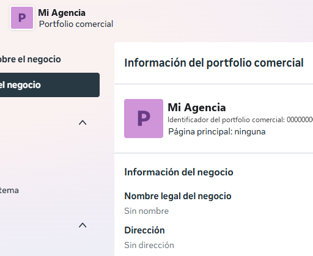

> **Consejo:** si vas a trabajar con clientes, usa un portfolio **solo para eso**, aparte del de tu negocio principal. Si algún día pasa algo con un cliente, tu negocio principal no se toca.

---

## Parte 3. Hacerte "desarrollador" (una sola vez)

Suena difícil, pero es solo registrarte para poder crear la app.

1. Entra a **developers.facebook.com** con tu cuenta de Facebook.
2. Arriba a la derecha toca **"Empezar"** (o "Get started").
3. Acepta las condiciones, confirma tu correo y tu celular (te llega un código).
4. Cuando te pregunte qué haces, elige la opción que más se parezca (por ejemplo, "Desarrollador").

Al terminar ves la pantalla **"Apps"**.

---

## Parte 4. Crear la app

**Paso 4.1.** En la pantalla "Apps" toca el botón verde **"Crear app"**.

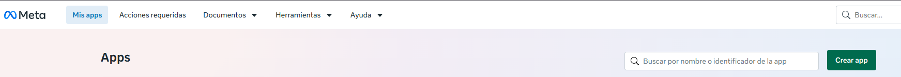

**Paso 4.2.** Puede aparecer un aviso que dice "Hay una nueva manera de crear apps". Toca **"Crear app"**.

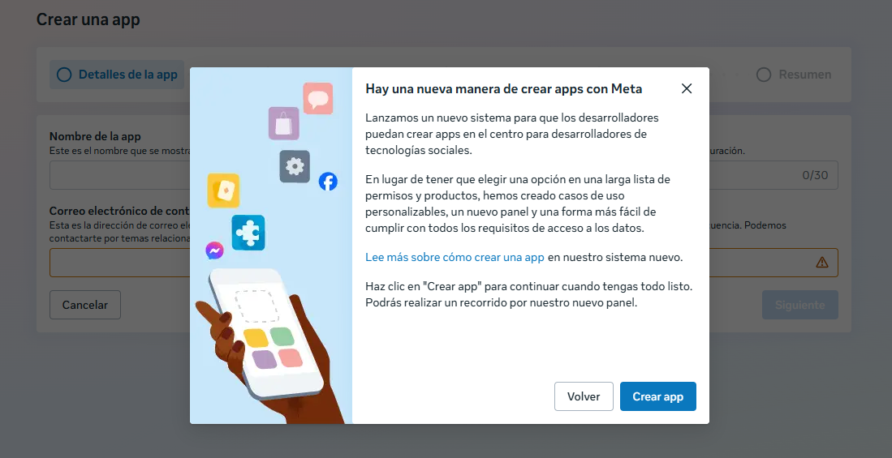

**Paso 4.3.** Escribe el **nombre de la app** (por ejemplo, el de tu negocio; no puede decir "Facebook" ni "Meta") y **tu correo**. Toca **Siguiente**.

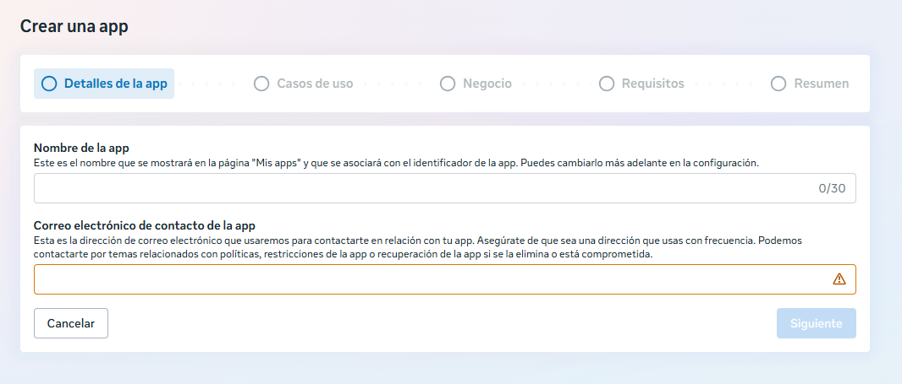

**Paso 4.4.** Ahora te pregunta para qué es la app ("Casos de uso"). A la izquierda toca **"Administración de contenido"**. Marca **solo dos**:
- **"Administrar mensajes y contenido en Instagram"**
- **"Administrar todos los aspectos de tu página"**

No marques las otras: cuantas más marques, más cosas te pide revisar Meta. Toca **Siguiente**.

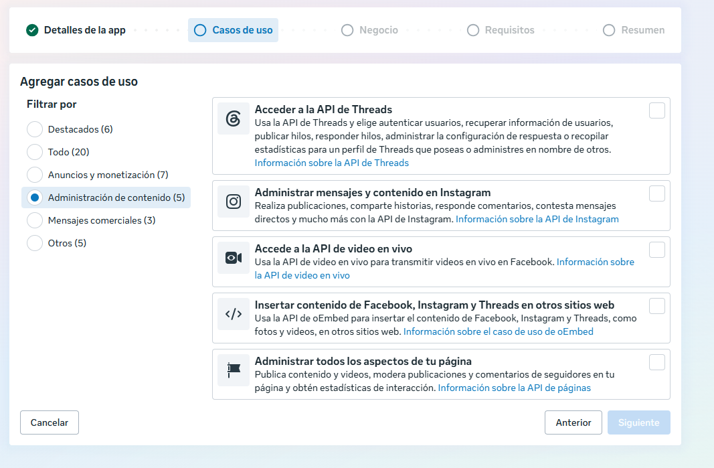

**Paso 4.5.** Elige el **portfolio comercial** de la Parte 2 (en la foto, "Mi Agencia"). Toca **Siguiente**.

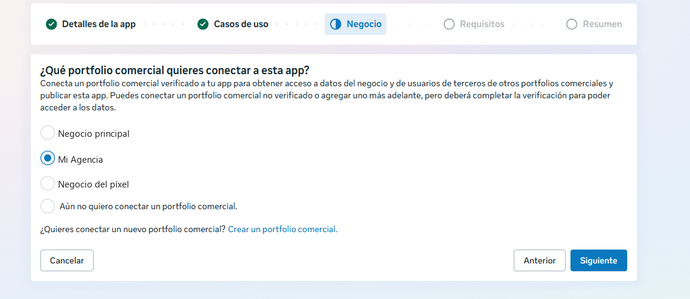

**Paso 4.6.** Si dice "No se identificaron requisitos", perfecto. Toca **Siguiente**.

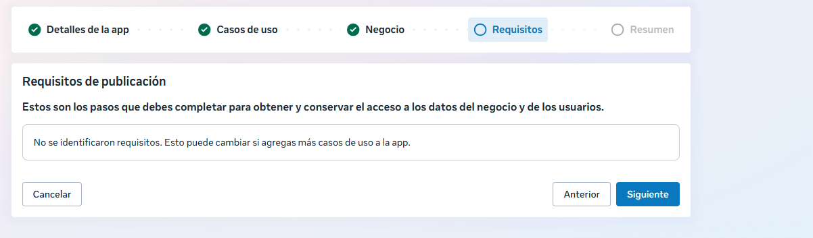

**Paso 4.7.** Revisa el resumen y toca **"Crear app"**. Puede pedirte tu contraseña de Facebook.

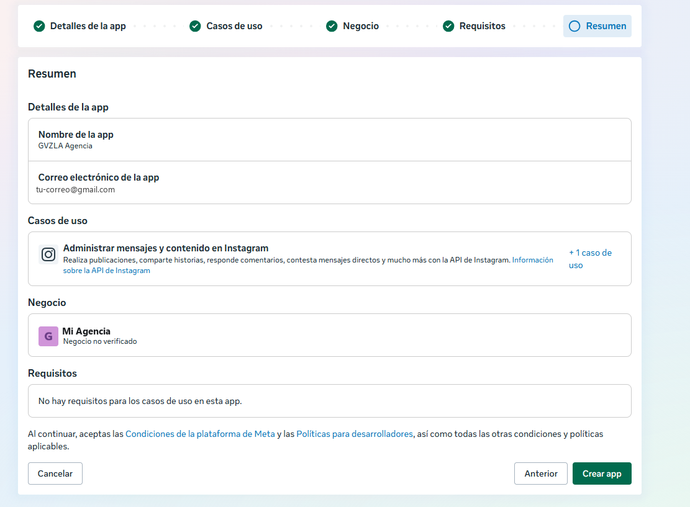

**Paso 4.8.** ¡Listo, la app existe! Ves su **Panel**. Lo de "Conviértete en proveedor de tecnología" es para trabajar con clientes más adelante: **no lo toques por ahora**.

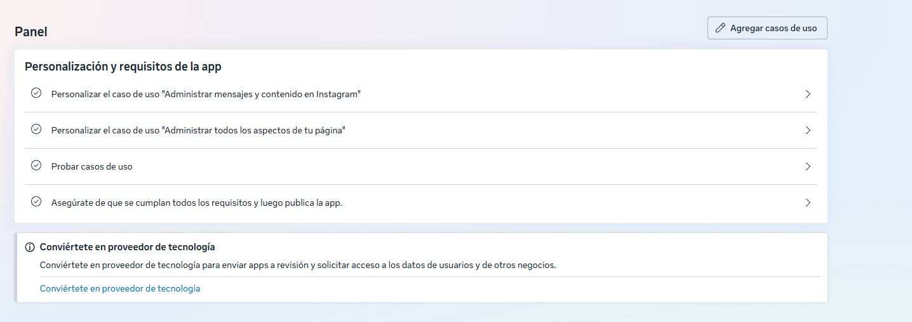

---

## Parte 5. Darle permisos a la app

Los permisos dicen qué puede hacer la app. Los agregamos uno por uno.

### 5.1 Permisos de la página

1. En el Panel toca **"Personalizar el caso de uso 'Administrar todos los aspectos de tu página'"**.
2. Ves una lista. Busca estos y toca **"Agregar"** en cada uno:
   - **pages_show_list:** ver la lista de tus páginas.
   - **pages_read_engagement:** leer lo que publican tus páginas y sus números.
   - **business_management:** ver tus portfolios.
   - **pages_manage_posts:** publicar (se usa más adelante; agregarlo ahora ahorra un paso).

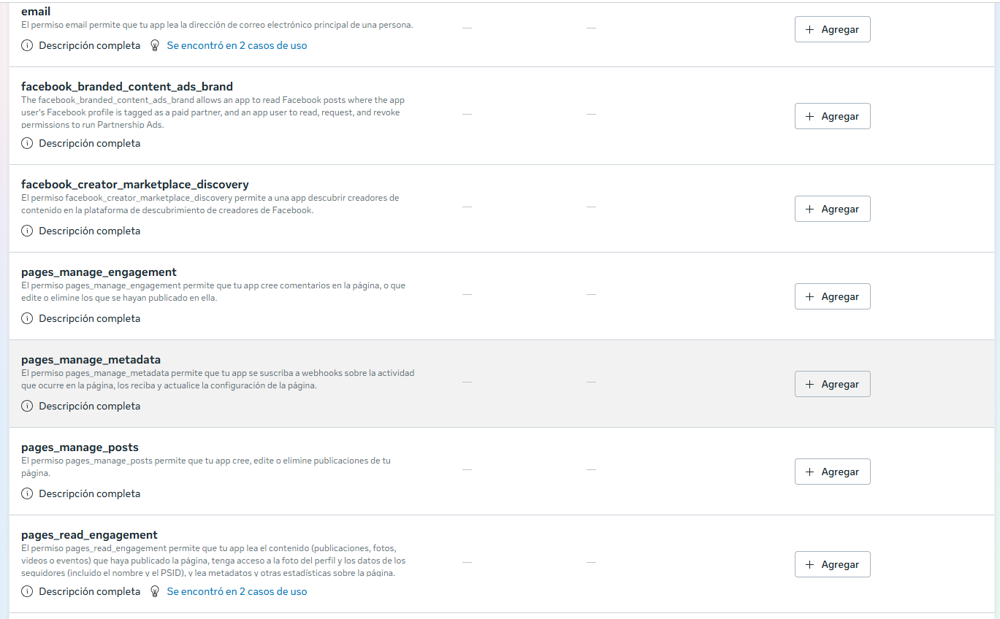

Si aparece un aviso que dice que otros casos de uso "se verán afectados", está bien: toca **"Agregar"**.

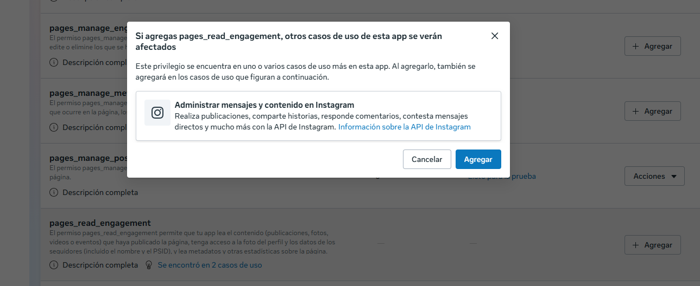

Cuando un permiso queda listo, dice **"Listo para la prueba"**:

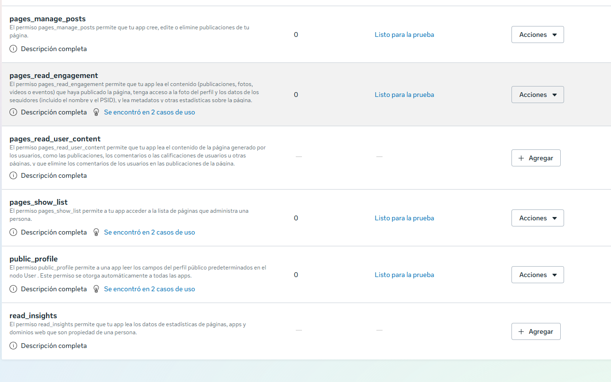

### 5.2 Permisos de Instagram y de anuncios

1. Arriba a la izquierda, en el menú que dice "Administrar páginas", cambia a **Instagram** (o vuelve al Panel y entra a "Personalizar" el caso de Instagram).
2. Toca **"Agregar"** en estos tres:
   - **instagram_basic:** ver tu cuenta de Instagram.
   - **instagram_content_publish:** publicar en Instagram (se usa más adelante).
   - **ads_read:** ver tus cuentas de anuncios y tus píxeles.

> **Ojo:** hay dos tipos de permisos de Instagram que se parecen. Usa los que **no** dicen "business" (por ejemplo, `instagram_basic`, **no** `instagram_business_basic`).

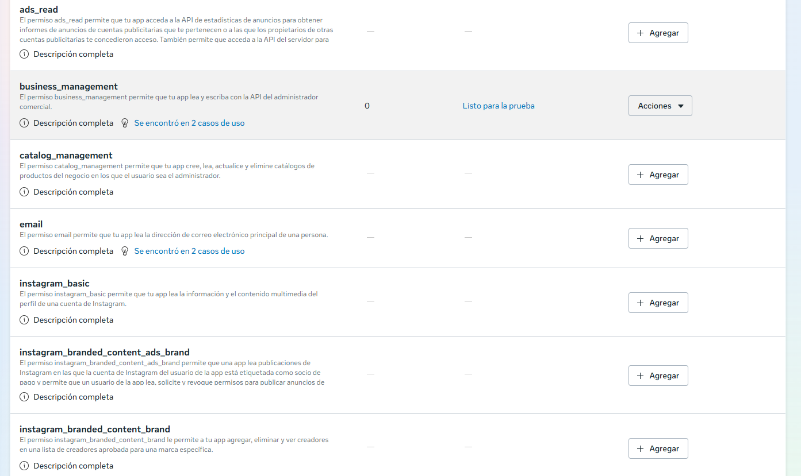

Así se ven cuando ya están listos:

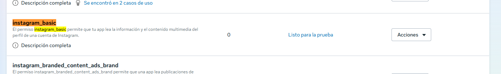

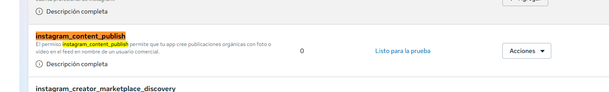

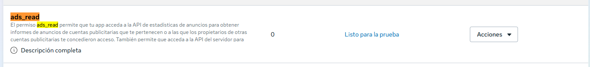

> Si te abre una pestaña llamada "API setup with Unified login", no es esa. A la izquierda toca **"Permisos y funciones"**.

---

## Parte 6. La dirección de vuelta

Cuando conectes, Facebook te devuelve a la app. Hay que decirle **a qué dirección**.

**Paso 6.1.** En el menú de la izquierda busca **"Inicio de sesión con Facebook para empresas"** y toca la flechita para abrirlo.

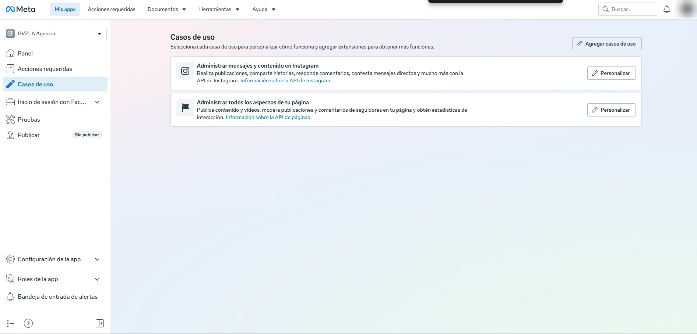

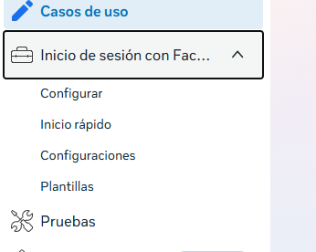

**Paso 6.2.** Toca **"Configurar"**. En el cuadro **"URI de redireccionamiento de OAuth válidos"** pega la dirección que te da la app (te la pasa quien instala la herramienta). Tiene esta forma:

```
https://TU-APP.com/api/conexiones/meta/callback
```

Aprieta **Enter**, baja hasta el final y toca **"Guardar cambios"**.

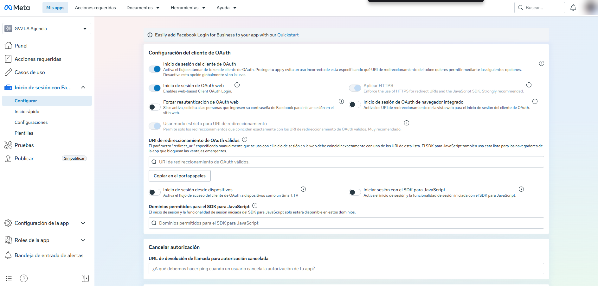

---

## Parte 7. La "configuración" de inicio de sesión

Las apps nuevas de Facebook piden una "configuración": una lista guardada de lo que la app le va a pedir a la persona que conecta.

**Paso 7.1.** En el mismo menú, toca **"Configuraciones"** y después **"Crear configuración"**. Ponle un nombre (por ejemplo, "Lectura") y toca **Siguiente**.

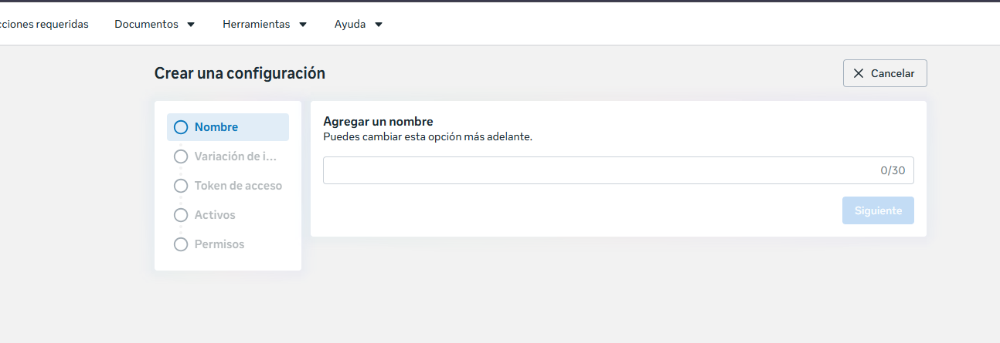

**Paso 7.2.** En "Variación de inicio de sesión" deja **"General"** y toca **Next**.

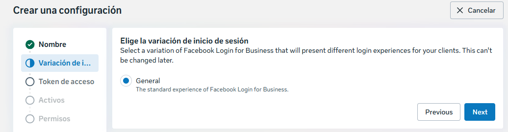

**Paso 7.3.** En "Token de acceso" marca **"Token de acceso de usuario"** (la primera opción). Es la que deja ver todos tus portfolios juntos. Toca **Siguiente**.

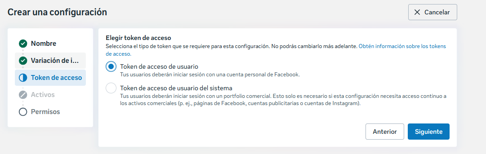

**Paso 7.4.** Abre **"Seleccionar permisos"**.

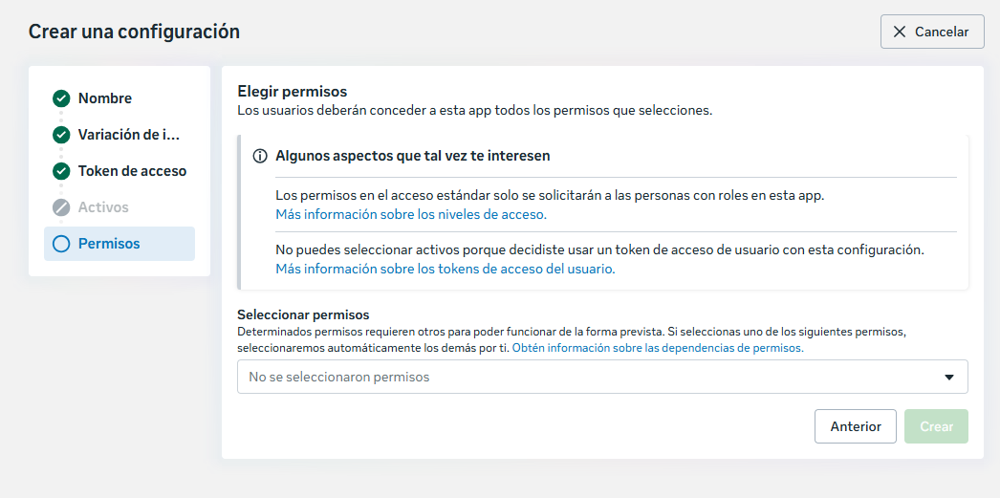

Marca **solo estos cinco**: `ads_read`, `business_management`, `instagram_basic`, `pages_read_engagement` y `pages_show_list`. **No** marques los de publicar todavía.

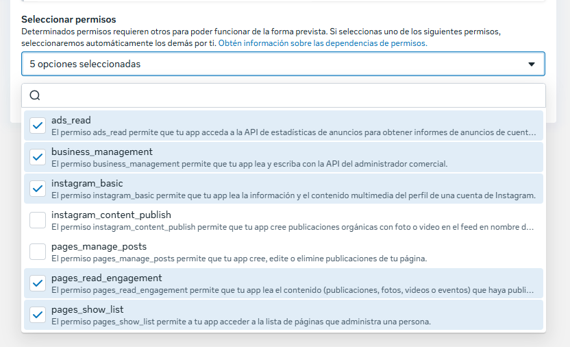

**Paso 7.5.** Toca **"Crear"**. Aparece el **identificador de configuración** (un número largo). **Cópialo y pásaselo a quien instala la herramienta.** Este número no es secreto.

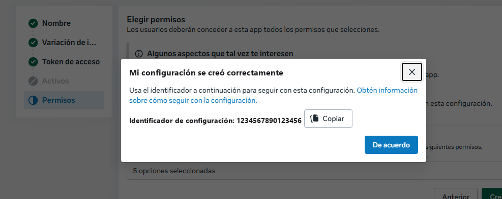

---

## Parte 8. La clave secreta (con cuidado)

La app tiene una **clave secreta**. Es como la llave de tu casa: **nunca** la mandes por WhatsApp, correo ni chat, y **nunca** la pegues en una página que no conoces.

1. En la app, a la izquierda, toca **"Configuración de la app"** y después **"Básica"**.
2. Ahí ves el **"Identificador de la app"** (ese número sí puedes pasarlo) y la **"Clave secreta de la app"**.
3. Toca **"Mostrar"** en la clave secreta (te pide tu contraseña de Facebook) y cópiala.
4. Pégala **solo** donde te indique la persona que instala la herramienta, en el servidor y en el momento. Mientras la pegas no se ve nada: es a propósito.

> **Consejo:** copia la clave **antes** de que te abran el lugar donde pegarla. Si ese lugar queda esperando mucho rato, se cierra solo y hay que volver a abrirlo.

---

## Parte 9. Conectar desde la app

**Paso 9.1.** Entra a la app y abre **Conexiones**. Baja hasta "Servicios". Antes de conectar, la tarjeta de Meta se ve así:

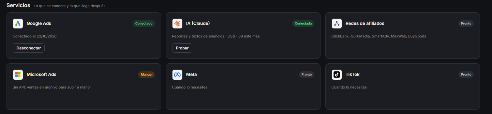

**Paso 9.2.** En la tarjeta **Meta** toca **"Conectar Meta"**. Se abre una ventana de Facebook. En cada pantalla deja marcado **"todos los actuales y futuros"** y toca **Continuar**:

Páginas:

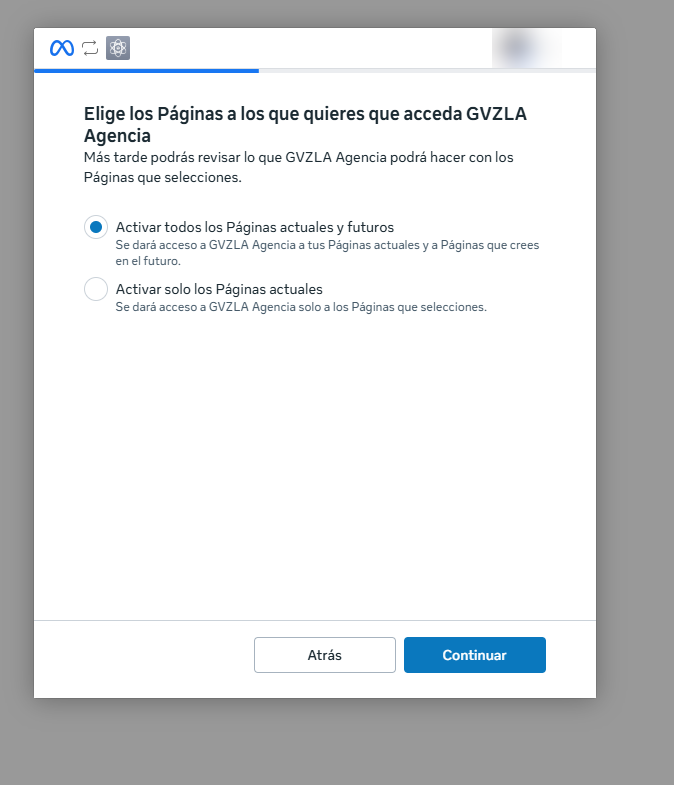

Negocios (portfolios):

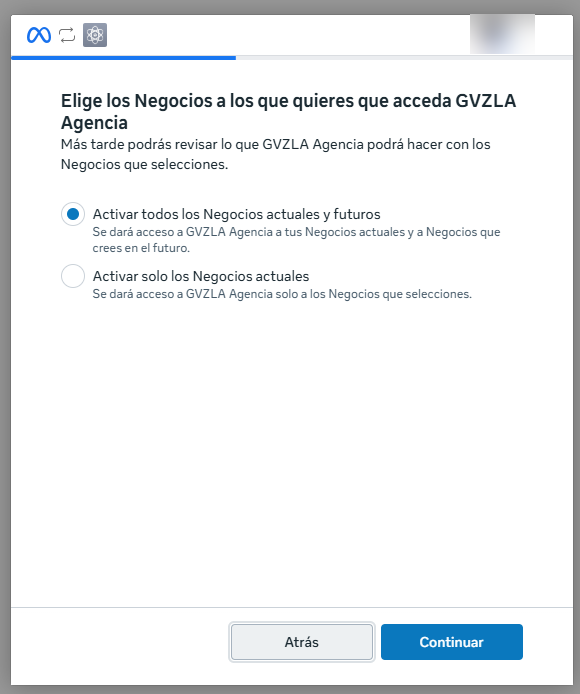

Instagram:

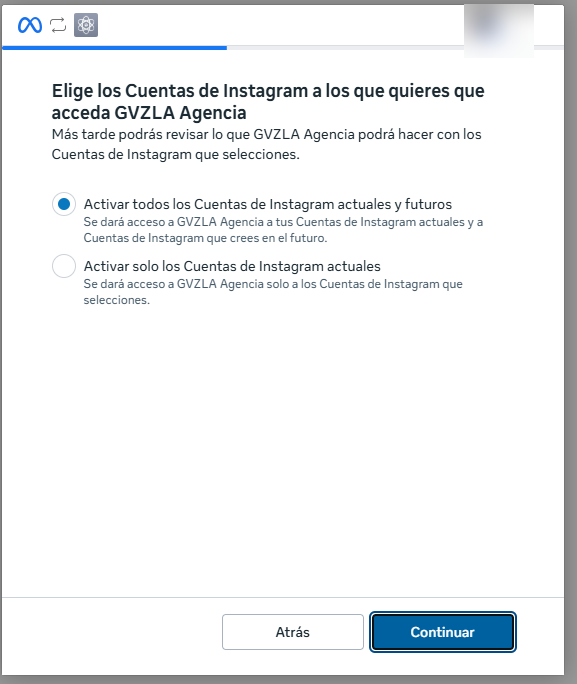

**Paso 9.3.** Facebook te muestra un resumen de lo que la app va a poder **ver**. Toca **"Guardar"**.

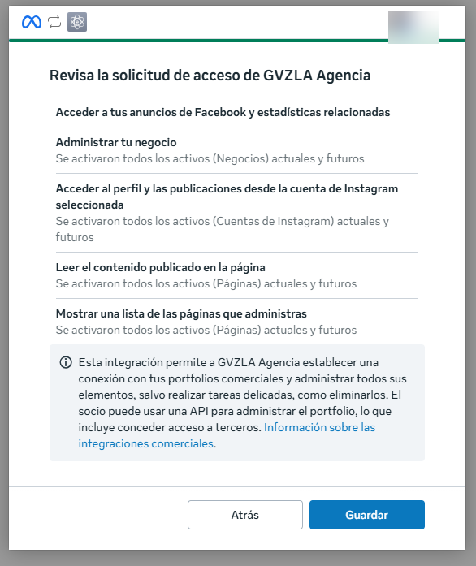

**Paso 9.4.** Listo. Toca **"De acuerdo"**.

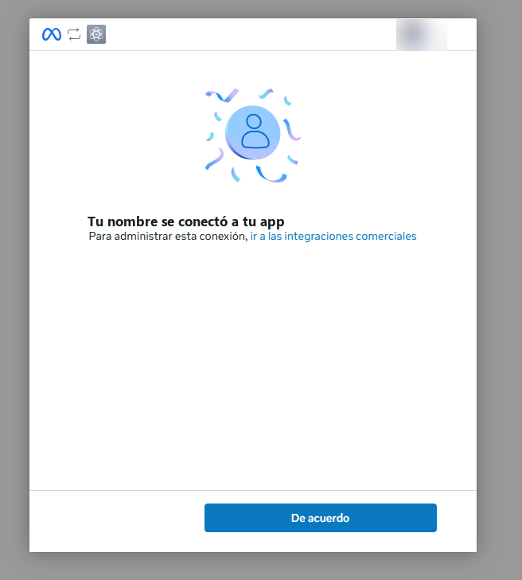

**Paso 9.5.** Vuelves a la app y ves todo tu Facebook, **cada cosa en su propia tabla**: portfolios (BM), páginas, Instagram, cuentas de anuncios y píxeles. Arriba de cada tabla dice cuántas están activas.

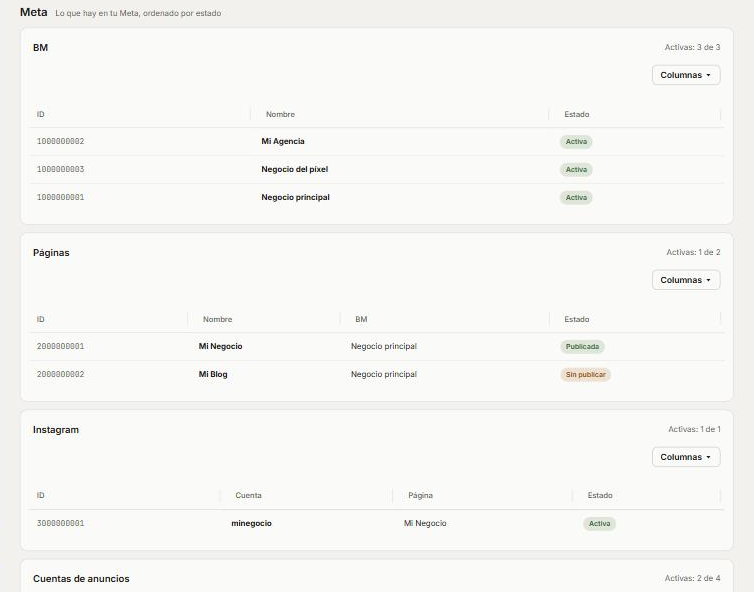

Las tablas están **ordenadas por estado**: primero las activas, después las que tienen algún problema (por ejemplo, "Pago pendiente") y al final las bloqueadas.

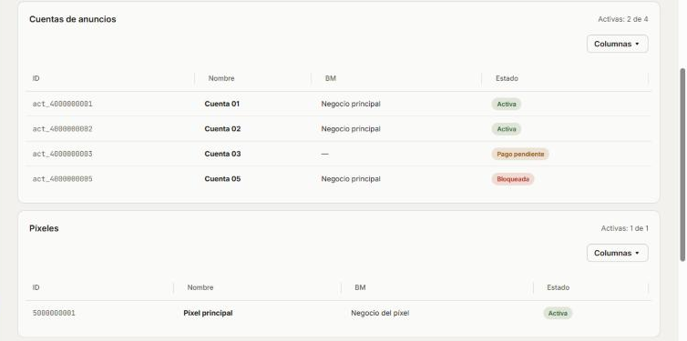

La tarjeta de Meta ahora dice **"Conectado"**, con quién la conectó y cuándo:

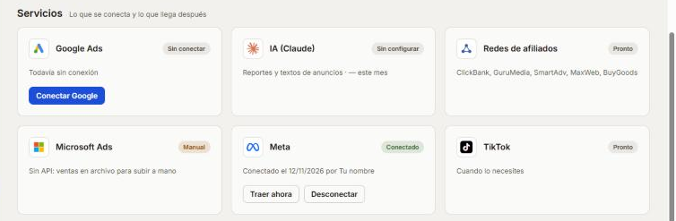

- **Traer ahora:** vuelve a leer tu Facebook en el momento. La app también lo lee sola cada mañana.
- **Desconectar:** corta la conexión. Lo que ya se leyó no se borra.

---

## Cada 60 días

Facebook da la conexión por **60 días**. Una semana antes, la app te avisa: "La conexión con Meta vence el …". Toca **"Reconectar"** y repite la Parte 9 (son dos minutos).

---

## Si algo sale mal

| Lo que ves | Qué hacer |
|---|---|
| Al tocar "Conectar Meta", Facebook dice que algo no está bien configurado | Revisa la Parte 6 (la dirección de vuelta, exacta y guardada) y que quien instala tenga el número de la Parte 7. |
| En una tabla dice "Meta no dio permiso para leer esto" | Falta un permiso: revisa la Parte 5 y la Parte 7 (los cinco permisos). Después, en la app, "Reconectar". |
| La tarjeta dice **"Cortada"** | La conexión venció o la quitaste en Facebook. Toca **"Reconectar"**. |
| Un portfolio o una página no aparece | En la Parte 9 no quedó marcado. Toca "Reconectar" y elige **"todos los actuales y futuros"**. Si la página es de otra persona que te dio acceso, quizá no aparezca su portfolio: es normal. |
| "Falta poner los datos de la app de Meta en el servidor" | Falta la Parte 8 o el número de la Parte 7: avísale a quien instala la herramienta. |

---

## Lo que esta conexión **no** hace (todavía)

- No publica en tus páginas ni en Instagram.
- No crea ni cambia anuncios.
- No toca nada de tu Facebook: **solo mira**.

Para trabajar con páginas de **clientes**, Facebook pide además **verificar tu negocio** (con documentos) y pasar una revisión de la app. Eso es otra guía.
