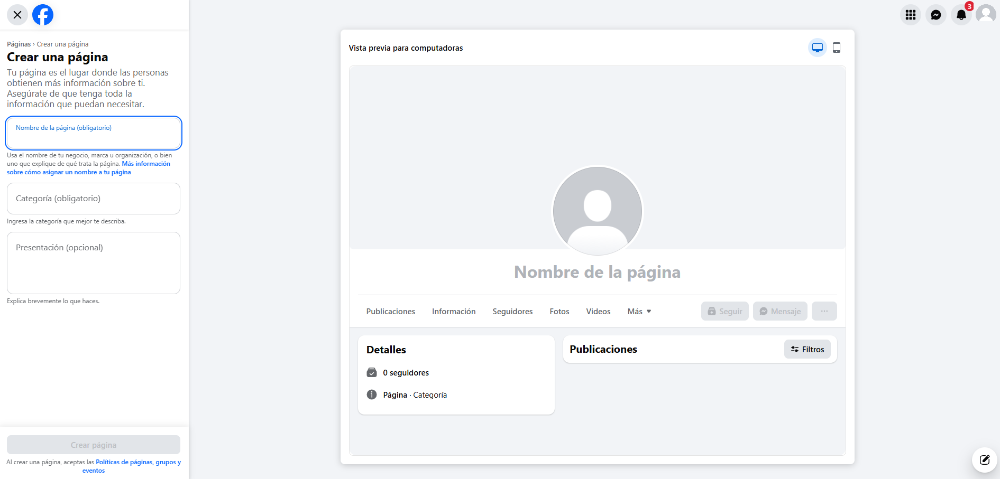
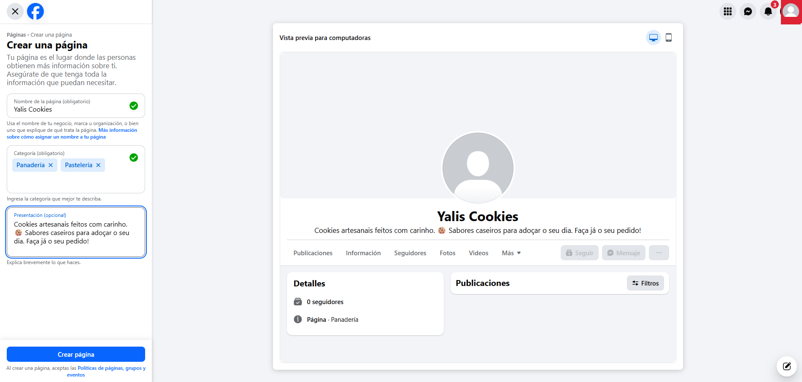
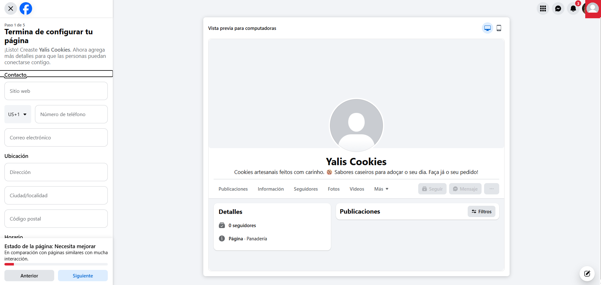
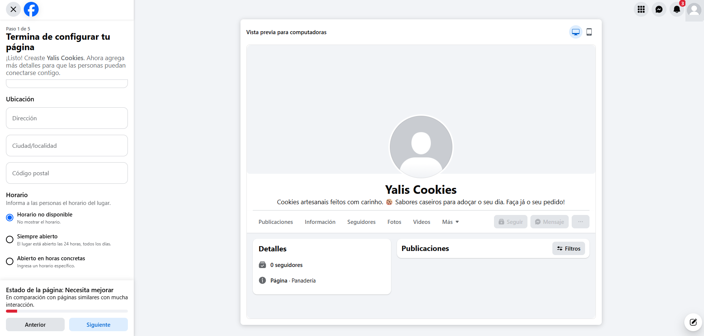
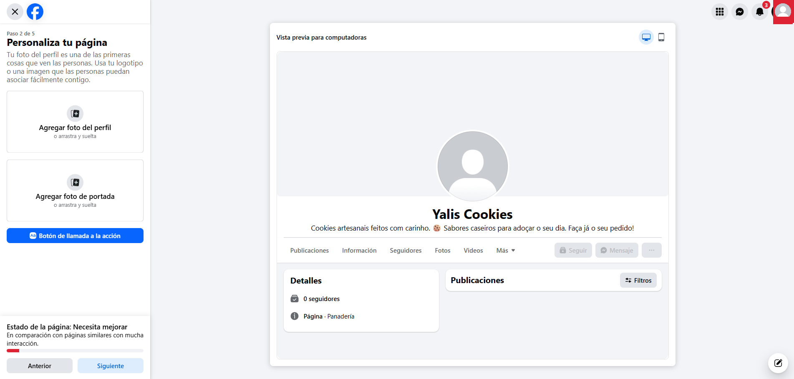
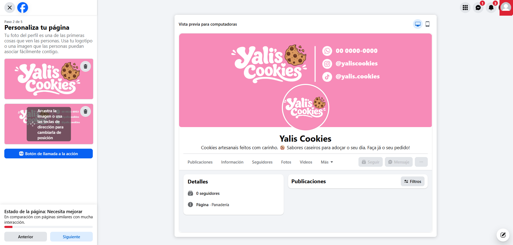
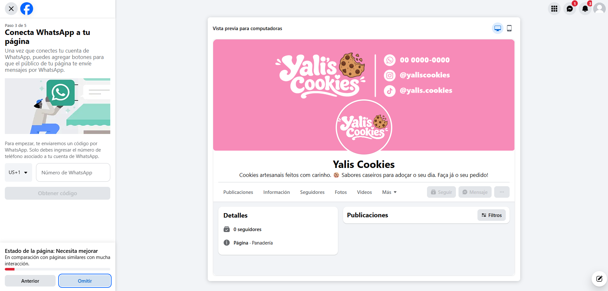
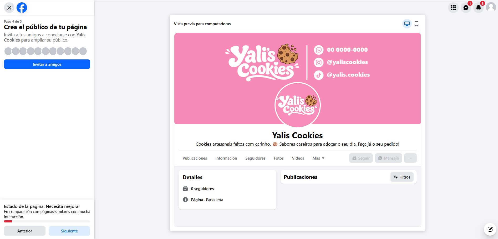
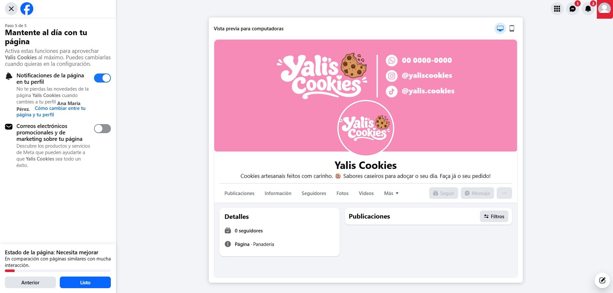
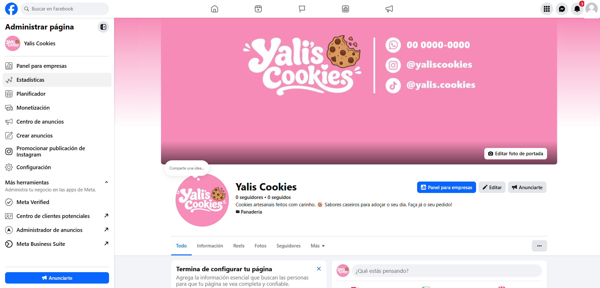

# Cómo crear una página de Facebook, paso a paso

Guía para crear una **página de Facebook** sin que Facebook se ponga estricto contigo. Vas despacio, un paso a la vez y mirando las fotos. Si una pantalla no se parece a la foto, no toques nada y pide ayuda.

> En las fotos usamos de ejemplo una página llamada **Yalis Cookies**. El número de teléfono y las personas que se ven son **de ejemplo**.

---

## Antes de empezar

**Qué vas a lograr:** una página de Facebook lista para usar, con nombre, categoría, descripción, foto de perfil y portada. Es el **día 1**. El día 2 son los ajustes de cuidado (ver más abajo).

**Qué necesitas:**

- Una computadora con internet.
- La cuenta de Facebook que va a ser **la dueña** de la página.
- El **logo** de tu negocio (para la foto de perfil) y una **portada** lista (ver "La portada").
- Unos **20 minutos**.

**Dos palabras que vas a ver mucho:**

| Palabra | Qué quiere decir |
|---|---|
| **Página** (o **fanpage**) | La "cara" de tu negocio en Facebook. La ven los clientes. No es tu perfil personal. |
| **Categoría** | El tipo de negocio. Facebook la muestra traducida al idioma de quien mira la página. |

### Por qué se hace despacio

Facebook **no publica** cuántas páginas se pueden crear por día. Lo que sí hace es vigilar señales raras: muchas páginas seguidas, desde la misma conexión y con cuentas nuevas. Cuando las ve, te avisa **"creaste demasiadas páginas"** o bloquea la cuenta por un tiempo.

Por eso esta guía va **por día** y **una sola página a la vez**. Ese orden **no es una regla de Facebook**: es la práctica que usamos para correr menos riesgo.

> **Si tu cuenta es nueva:** antes de crear páginas conviene "calentarla" unos 5 días, usándola como una persona normal (ver el feed, dar "me gusta", publicar algo, agregar de a poco a algunos amigos). Si tu cuenta ya tiene tiempo y hace mucho que no creas páginas, puedes saltarte esto.

---

## Parte 1. Crear la página

**Paso 1.1.** Entra con la cuenta que va a ser la dueña y abre esta dirección:

```
https://www.facebook.com/pages/create
```

Te aparece la pantalla "Crear una página". A la derecha ves cómo va quedando.



**Paso 1.2.** Llena tres cosas:

1. **Nombre de la página.** El nombre de tu negocio. Aparece una tilde verde cuando está bien.
2. **Categoría.** Escribe una palabra (por ejemplo `Panadería`) y **elige una opción de la lista**. Puedes elegir más de una. Si no sale lo que buscas, prueba con otra palabra parecida (`Pastelería`, `Repostería`).
3. **Presentación.** Una o dos frases sobre lo que haces. Es opcional, pero conviene ponerla.



> **¿La página es en otro idioma?** Escribe la presentación en el idioma de tus clientes. La categoría no importa: Facebook la traduce sola (en español dice "Panadería", en portugués "Padaria").

**Paso 1.3.** Toca **"Crear página"**. Facebook te lleva a "Termina de configurar tu página", un asistente de 5 pasos. Sigue con la Parte 2.

---

## Parte 2. Terminar de configurar (los 5 pasos de Facebook)

### Paso 1 de 5: contacto y ubicación

Facebook pide sitio web, teléfono, correo y dirección. **Déjalos vacíos todos.** Se agregan después, cuando haga falta. Una página nueva con pocos datos levanta menos sospechas que una cargada de datos el primer día.



Más abajo está el **Horario**. Marca **"Horario no disponible"**. La dirección y la ciudad quedan vacías (no hay casilla para decir "sin ubicación"). Toca **"Siguiente"**.



### Paso 2 de 5: fotos

Aquí subes la **foto de perfil** (el logo) y la **portada**. Toca cada cuadro y elige el archivo.



Cuando subes la portada, puedes arrastrarla para moverla. Mira la vista previa de la derecha: la **foto de perfil se come un pedazo** de la portada por abajo, así que lo importante tiene que quedar **arriba**.



**El botón de llamada a la acción** ("Compre ahora", "Saiba mais"…): **no lo pongas hoy.** Casi todos piden la página web. Lo agregas cuando la tengas.

### La portada

Qué medidas y qué tener en cuenta:

| Dato | Valor |
|---|---|
| Tamaño para subir | **1640 x 624** píxeles (se ve nítida) |
| Lo que se muestra en computadora | 820 x 312 |
| En el celular | Facebook **corta los lados**: deja lo importante en el **centro** |
| Foto de perfil | Tapa la parte de abajo. Pon logo y datos **en la mitad de arriba** |

> **¿Pones el teléfono en la portada?** Si sigues la regla de "página sin número el primer día", no lo pongas todavía: ponlo solo si ya decidiste mostrarlo.

### Paso 3 de 5: conectar WhatsApp

Facebook te ofrece conectar WhatsApp. Toca **"Omitir"**. Se conecta más adelante, cuando la página ya esté asentada.



### Paso 4 de 5: invitar amigos

Facebook te ofrece invitar a tus amigos. **No lo hagas.** Esos amigos son de tu perfil personal: invitarlos une tu perfil con la página. Toca **"Siguiente"**.



### Paso 5 de 5: notificaciones

Deja los interruptores como están: **notificaciones de la página encendidas** y **correos de marketing apagados**. Toca **"Listo"**.



---

## Parte 3. Tu página ya existe

Facebook te lleva a la página recién creada. A la izquierda ves el menú **"Administrar página"** y arriba la portada con tu logo.



**Hasta aquí es el día 1.** No sigas esta noche: Facebook ve mejor los cambios repartidos en varios días que todo de golpe.

---

## Día 2 (próximamente con fotos)

Para el día siguiente:

- Apagar las **reseñas** de la página, para no recibir malas calificaciones.
- Poner el **género** en "Información".
- Configurar el **asistente de moderación** para no recibir comentarios negativos.

Después vienen: crear el Instagram de la página, programar publicaciones en Meta Business Suite, meter la página al portfolio comercial (BM) y empezar a usarla con la cuenta de anuncios.

---

## Si algo sale mal

| Lo que ves | Qué hacer |
|---|---|
| "Creaste demasiadas páginas" | Es un bloqueo temporal. **No intentes crear otra** con esa cuenta hasta que pase. |
| No sale mi categoría en la lista | Escribe otra palabra parecida y elige una opción de la lista. |
| La portada se corta en el celular | Tenías datos en los lados. Pon todo en el **centro** y vuelve a subirla. |
| La foto de perfil tapa mi portada | Sube el contenido: lo importante va en la mitad de **arriba**. |
| La página aparece "no publicada" o "restringida" | Entra a **Configuración de la página > General** y revisa los avisos. Para pedir revisión usa la **Bandeja de entrada de ayuda** (Support Inbox). |
| Me restringieron la cuenta | Facebook cuenta las infracciones: con 7 te bloquea un día para crear contenido (incluye páginas) y con 8, tres días. Espera y no crees nada hasta entonces. |

---

Fuentes: [Cómo restringe cuentas Meta](https://transparency.meta.com/enforcement/taking-action/restricting-accounts/) · [Arreglar "creaste demasiadas páginas"](https://digitalmarketingskill.com/?p=42148) · [Páginas despublicadas](https://socialrails.com/blog/facebook-unpublished-my-page-fix). El ritmo por día es una práctica de la comunidad, no una norma publicada por Meta.
