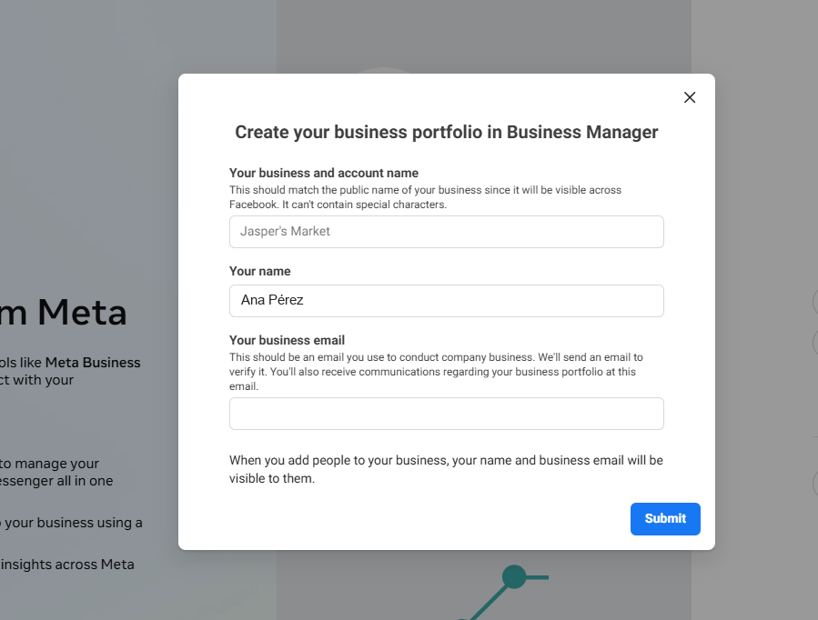
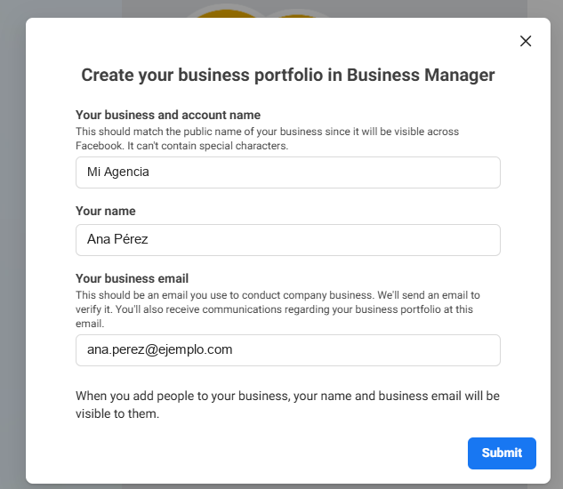
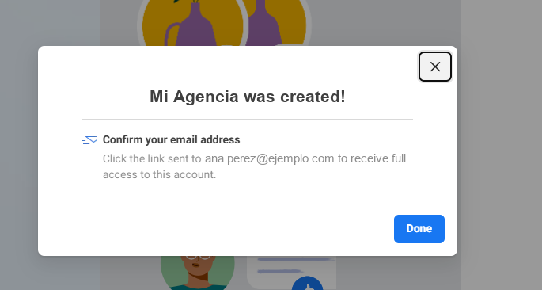
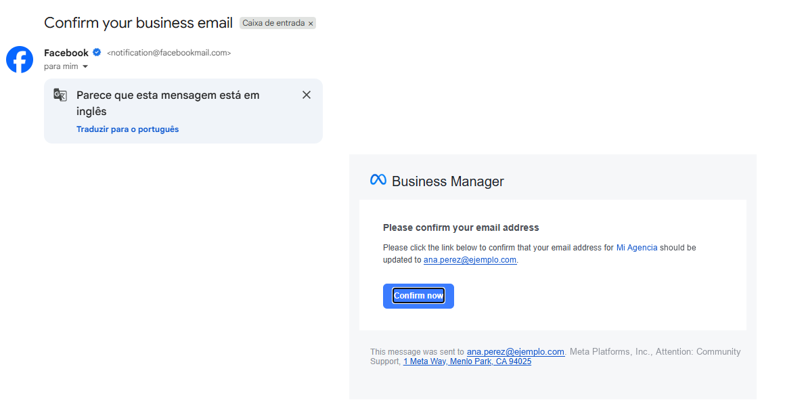
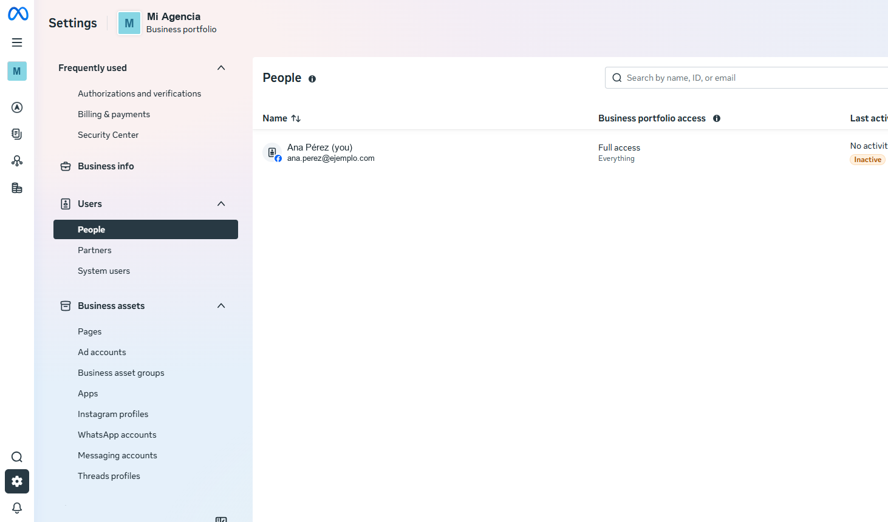

# Cómo crear un portfolio comercial, paso a paso

Guía para crear tu **portfolio comercial** de Meta (antes se llamaba "Business Manager" o "BM"). Vas despacio, un paso a la vez y mirando las fotos. Si una pantalla no se parece a la foto, no toques nada y pide ayuda.

> En las fotos usamos de ejemplo un portfolio llamado **Mi Agencia**, de **Ana Pérez**, con el correo **ana.perez@ejemplo.com**. Son datos **de ejemplo**.

---

## Antes de empezar

**Qué vas a lograr:** tu portfolio comercial creado y con tu correo confirmado. Es la "oficina" de tu negocio en Meta: ahí van a vivir tus páginas, tus Instagram, tus cuentas de anuncios y tus píxeles.

**Qué necesitas:**

- Una computadora con internet.
- Tu **cuenta de Facebook** personal, con tu nombre real. Si no tienes, mira la [Parte 1 de "Conectar Facebook e Instagram"](conectar-meta.md#parte-1-tu-cuenta-de-facebook).
- Un **correo de tu negocio** que revises seguido (te llega un correo para confirmar).
- Unos **10 minutos**.

**Tres palabras que vas a ver:**

| Palabra | Qué quiere decir |
|---|---|
| **Portfolio comercial** (business portfolio) | La "oficina" de tu negocio en Meta. Antes se llamaba **Business Manager** o **BM**. |
| **Business email** | El correo del negocio. Meta te escribe ahí por todo lo del portfolio. |
| **People** (personas) | Quiénes entran a tu portfolio y qué pueden hacer. |

> **Consejo:** si vas a trabajar con clientes, usa un portfolio **solo para eso**, aparte del de tu negocio principal. Si algún día pasa algo con un cliente, tu negocio principal no se toca.

---

## Parte 1. Abrir el formulario

1. Entra a **business.facebook.com** con tu cuenta de Facebook.
2. Si todavía no tienes un portfolio, Facebook te ofrece crearlo: toca **"Crear un portfolio comercial"** (o **"Create a business portfolio"**).
3. Si ya tienes uno, toca arriba a la izquierda el **nombre de tu portfolio** y elige **"Crear un portfolio comercial"**.

Se abre esta ventana. Tu nombre ya viene escrito.

---

## Parte 2. Llenar los datos

Llena los tres cuadros:

| Cuadro | Qué escribes |
|---|---|
| **Your business and account name** (nombre del negocio) | El **nombre público** de tu negocio, como lo van a ver los demás en Facebook. **Sin** signos raros (nada de `&`, `@`, `!`, emojis). En la foto: "Mi Agencia". |
| **Your name** (tu nombre) | Tu nombre y apellido. Ya viene escrito: déjalo así. |
| **Your business email** (correo del negocio) | Un correo que **revises seguido**. Te llega un correo para confirmar. |

Toca el botón azul **Submit** (Enviar).

> **Ojo:** las personas que agregues a tu portfolio van a ver **tu nombre y este correo**. Usa uno que no te moleste mostrar.

---

## Parte 3. El portfolio queda creado

Aparece el aviso **"Mi Agencia was created!"** (fue creado), con un recordatorio: **confirma tu correo**. Toca **Done** (Listo).

---

## Parte 4. Confirmar el correo

Sin este paso el portfolio **no queda con acceso completo**.

1. Abre tu correo. Busca uno de **Facebook** que dice **"Confirm your business email"** (confirma el correo de tu negocio). Si no está, mira en **Spam** o **Promociones**.
2. Dentro dice **"Please confirm your email address"**. Toca el botón azul **Confirm now** (Confirmar ahora).

Se abre Facebook y el correo queda confirmado.

---

## Parte 5. Revisar que todo quedó bien

1. Entra a **business.facebook.com** y toca la **tuerca** (Configuración), abajo a la izquierda.
2. Arriba ves el nombre de tu portfolio (**Mi Agencia**, "Business portfolio").
3. En el menú toca **Users** (Usuarios) → **People** (Personas).

Tienes que aparecer **tú, "(you)"**, con tu correo y **Full access** (acceso total, "Everything").

> Que al lado diga **"No activity"** o **"Inactive"** apenas lo creas no es un problema: el portfolio es nuevo y todavía no hiciste nada en él.

¡Listo! Ya tienes tu portfolio.

---

## Lo que sigue

1. **[Proteger tu portfolio](proteger-portfolio.md):** pedir el código del celular a todos y sumar un **segundo administrador**. Hazlo pronto: un portfolio con un solo dueño se pierde si a esa cuenta le pasa algo.
2. **[Conectar Facebook e Instagram](conectar-meta.md):** para que la herramienta vea tu portfolio.

---

## Si algo sale mal

| Lo que ves | Qué hacer |
|---|---|
| "It can't contain special characters" (no puede tener caracteres especiales) | Saca los signos del nombre (`&`, `@`, `!`, emojis, comillas). Deja solo letras, números y espacios. |
| No me llega el correo para confirmar | Mira en **Spam** y **Promociones**. Si no está, entra a la tuerca → **Business info** (Información del negocio) y revisa que el correo esté bien escrito. |
| Me equivoqué en el correo | Cámbialo en la tuerca → **Business info**. Te llega un correo nuevo para confirmar. |
| No me deja crear otro portfolio | Facebook limita cuántos portfolios crea una misma cuenta. **No crees portfolios de prueba.** Usa uno que ya tengas o pide ayuda. |
| No veo "Crear un portfolio comercial" | Toca arriba a la izquierda el nombre de tu portfolio: la opción está al final de esa lista. |
