# Cómo proteger tu portfolio comercial de Facebook, paso a paso

Guía para dejar **seguro** el portfolio comercial donde guardas lo importante de tu negocio. Vas despacio, un paso a la vez y mirando las fotos. Si una pantalla no se parece a la foto, no toques nada y pide ayuda.

> En las fotos, los nombres, correos y el negocio ("Mi Agencia") son **de ejemplo**.

---

## Antes de empezar

**Qué vas a lograr:** que nadie pueda entrar a tu portfolio aunque le roben la contraseña a alguien, y que tu portfolio no quede sin dueño si un día pierdes tu cuenta de Facebook.

**Qué necesitas:**

- Una computadora con internet.
- Tu celular a mano (Facebook te pide códigos).
- Tener **control total** del portfolio. Si no lo tienes, no vas a ver estas opciones.
- Unos **15 minutos**.

**Dos palabras que vas a ver mucho:**

| Palabra | Qué quiere decir |
|---|---|
| **Portfolio comercial** (o **BM**) | La "oficina" de tu negocio dentro de Facebook. Ahí viven tus páginas, cuentas de anuncios y píxeles. |
| **Control total** (o **Administrar**) | El permiso más alto: puede cambiar todo, agregar o quitar personas y hasta borrar el portfolio. |

**Para empezar:** entra a **business.facebook.com/settings**. Arriba a la izquierda tiene que aparecer el nombre de **tu** portfolio. Si aparece otro, tócalo y elige el tuyo.

---

## Parte 1. Pedir un código del celular a todos

**Para qué sirve:** cada vez que alguien entra a tu portfolio desde una computadora o un navegador nuevo, además de la contraseña tiene que poner un código que le llega al celular. Si alguien roba una contraseña, igual no puede entrar.

**Paso 1.1.** En el menú de la izquierda toca **"Información sobre el negocio"** y baja hasta **"Opciones del negocio"**. Al lado de **"Autenticación en dos pasos"** vas a ver una lista. Si dice **"Nadie"**, hoy no se le pide el código a nadie.

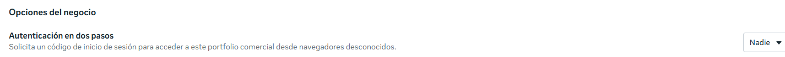

**Paso 1.2.** Toca la lista, elige **"Todos"** y confirma. Funciona desde ese momento.

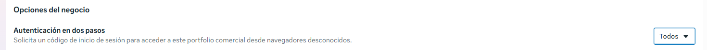

**Las tres opciones:**

| Opción | Qué hace |
|---|---|
| **Todos** (la que recomendamos) | Todos los que entran a tu portfolio tienen que usar el código. |
| **Solo administradores** | Solo los que tienen control total. |
| **Nadie** | Apagado. |

> **¿Se puede deshacer?** Sí, volviendo a "Nadie". Pero en algunos portfolios con más de 90 días, Facebook lo deja obligatorio y no se puede apagar.

> **Ojo:** si tu Facebook todavía no tiene el código activado, Facebook te lo va a pedir antes de dejarte entrar. Y si usas ventana privada o borras el historial al cerrar el navegador, te va a pedir el código cada vez.

---

## Parte 2. Agregar un segundo administrador

**Para qué sirve:** si un día pierdes tu cuenta de Facebook (te la roban, Facebook la bloquea o pierdes el celular de los códigos), tu portfolio no queda sin dueño. La otra persona entra y te vuelve a agregar. Si eres el único administrador y pierdes tu cuenta, recuperar el portfolio es **muy difícil**. Facebook recomienda tener más de una persona con control total.

**El riesgo:** esa persona va a poder hacer lo mismo que tú, incluso quitarte o borrar el portfolio. Por eso tiene que ser **alguien de mucha confianza** (tu pareja, un socio, un familiar). Si no tienes a nadie así, es mejor no ponerlo.

> **Nunca uses una segunda cuenta tuya.** Facebook no permite que una persona tenga dos cuentas personales y puede bloquear las dos. Ahí perderías justo lo que estás cuidando.

**Paso 2.1.** En el menú de la izquierda toca **Usuarios → "Personas"**. Arriba a la derecha toca el botón azul **"Invitar a personas"**.

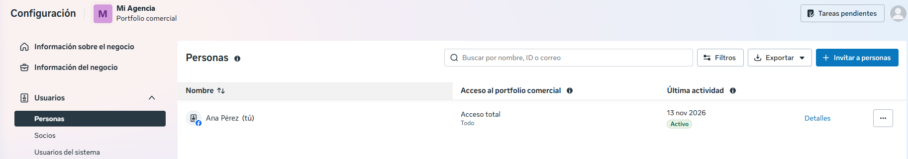

**Paso 2.2.** Escribe el correo con el que esa persona entra a **su** Facebook (tiene que ser ese mismo). Deja **"Acceso temporal"** apagado. Toca **"Siguiente"**.

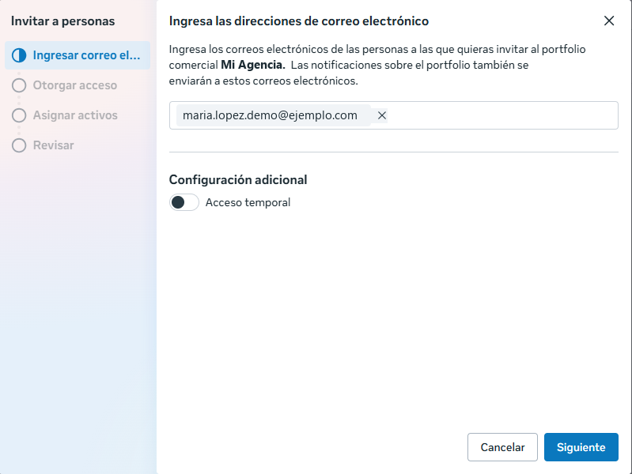

**Paso 2.3.** En **"Acceso total"**, prende **"Administrar"**. Facebook te va a mostrar un aviso amarillo que dice que no le des control a mucha gente: es normal, porque es una sola persona y de confianza. Toca **"Siguiente"**.

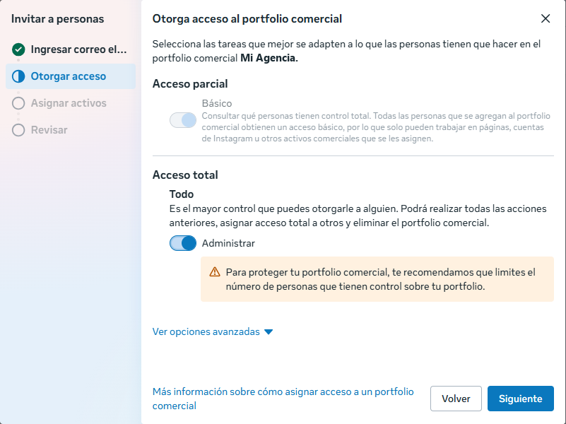

**Paso 2.4.** En **"Asignar activos comerciales"** **no marques nada**: con acceso total ya puede manejar todo el portfolio. Si se abrió una lista, ciérrala con la tecla **Esc**. Toca **"Siguiente"**.

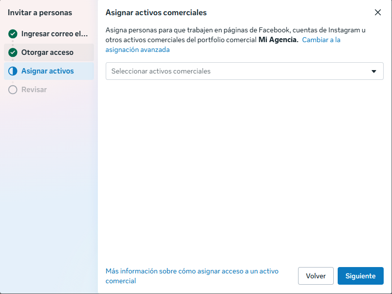

**Paso 2.5.** Revisa que diga **"Acceso total: Todo"**. Que diga "No hay activos asignados" está bien. Toca **"Invitar con 0 activos"**.

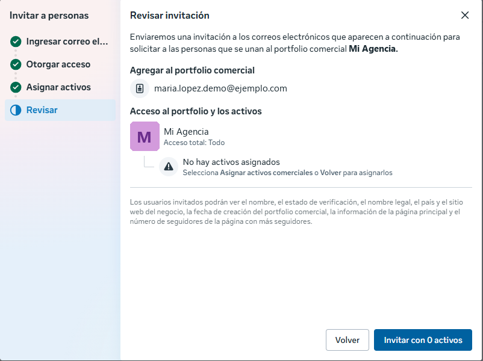

**Paso 2.6.** Listo: la persona aparece en la lista como **"Invitado"** hasta que acepte.

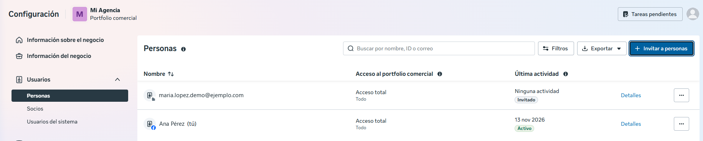

> **¿Se puede deshacer?** Sí. En "Personas", toca los tres puntitos (**…**) al lado de su nombre para cambiarle el acceso o quitarla.

---

## Parte 3. La otra persona acepta

Esta parte la hace **la otra persona, con su propio Facebook**, no tú. Le llega un correo de Facebook con la invitación.

**Paso 3.1.** Revisa su nombre. La casilla de mensajes de marketing puede quedar **sin marcar**. Toca **"Continuar"**.

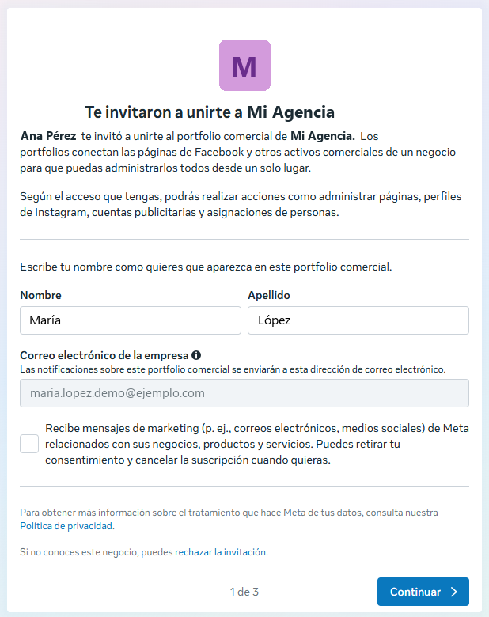

**Paso 3.2.** Revisa que el portfolio sea el tuyo. Que diga "Sin verificar" es normal si todavía no verificaste tu negocio. Toca **"Continuar"**.

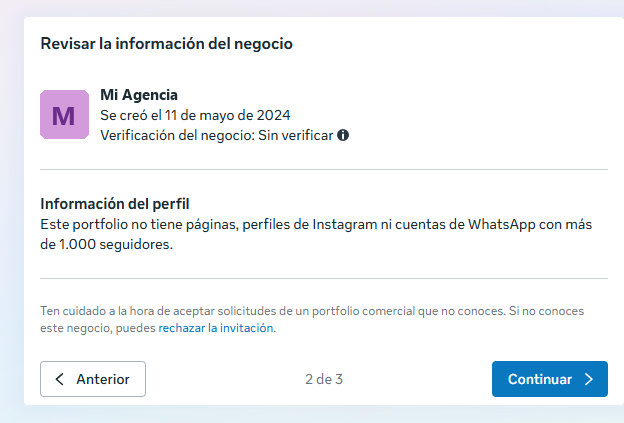

**Paso 3.3.** Toca **"Aceptar invitación"**. En tu lista de "Personas" ya no dice "Invitado".

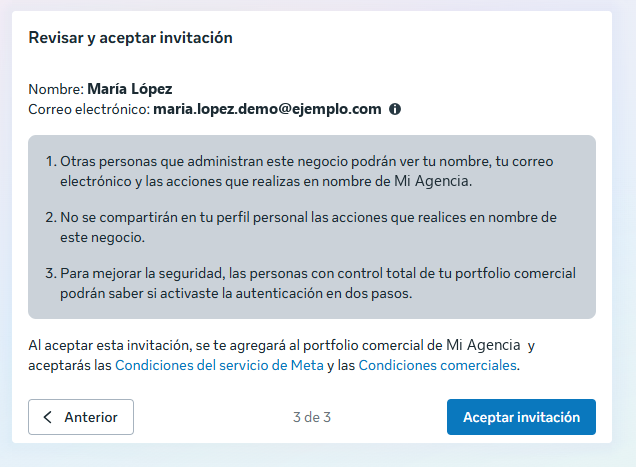

---

## Parte 4. Verificar tu página web (el dominio)

**Para qué sirve:** le demuestras a Facebook que tu página web (por ejemplo, tu blog) es tuya. Así **nadie más** puede cambiar cómo se ven los enlaces de tu página cuando se comparten en Facebook, ni usarla en anuncios a tu nombre. Es gratis y **no hace falta tener empresa**.

**Qué necesitas:** entrar al lugar donde compraste tu dominio (en esta guía, **Hostinger**). Si tienes varias páginas web, repites esta parte con cada una.

> Un dominio solo puede estar en **un** portfolio. Ponlo en el portfolio donde guardas lo importante, no en uno que usas para anunciar.

### En Facebook: agregar el dominio

**Paso 4.1.** En el menú de la izquierda abre **"Seguridad e idoneidad de la marca"** y toca **"Dominios"**. Toca **"Agregar"**.

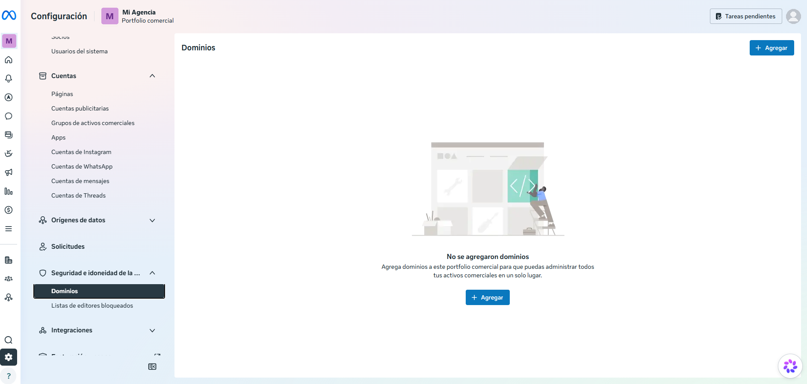

**Paso 4.2.** Elige **"Crear un dominio"**. Aunque diga "crear", no compras nada: es para agregar un dominio que ya es tuyo.

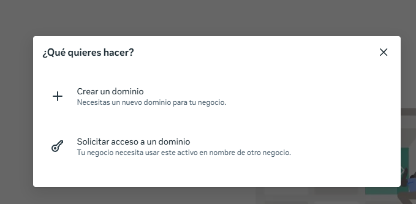

> **Ojo:** **no** elijas "Solicitar acceso a un dominio". Esa opción es para pedirle permiso a otro negocio por un dominio que es de ellos.

**Paso 4.3.** Escribe tu dominio **sin** `https://` y **sin** `www` (por ejemplo, `miblog.com`). Toca **"Agregar"**.

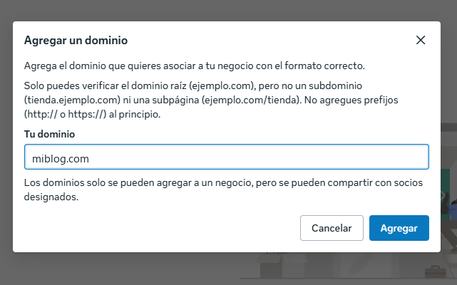

**Paso 4.4.** Tu dominio aparece en la lista como **"No verificado"**. Tócalo para ver cómo verificarlo.

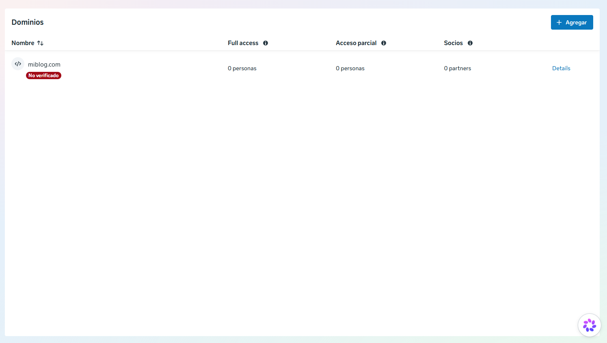

**Paso 4.5.** En **"Selecciona una opción"** elige **"Actualizar el registro TXT de DNS con el registrador de dominios"**. Facebook te muestra un texto que empieza con `facebook-domain-verification=`. **Cópialo completo** y deja esta pestaña abierta.

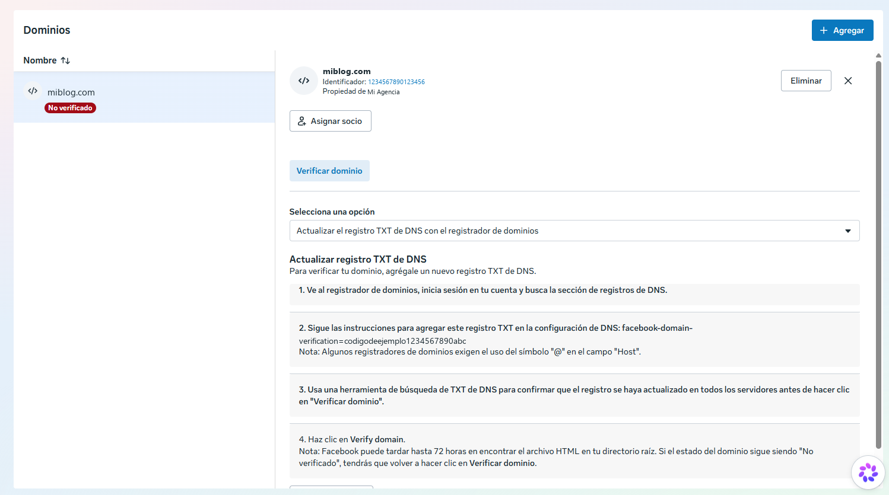

> **¿Por qué esta opción?** Las otras dos obligan a cambiar el código de tu página web. Esta se hace en el panel de tu dominio, **no toca tu página** y queda para siempre, aunque cambies o vuelvas a subir tu web.

### En Hostinger: pegar el código

**Paso 4.6.** En otra pestaña entra a **hpanel.hostinger.com** → **Domínios** → tu dominio → **DNS / Nameservers**.

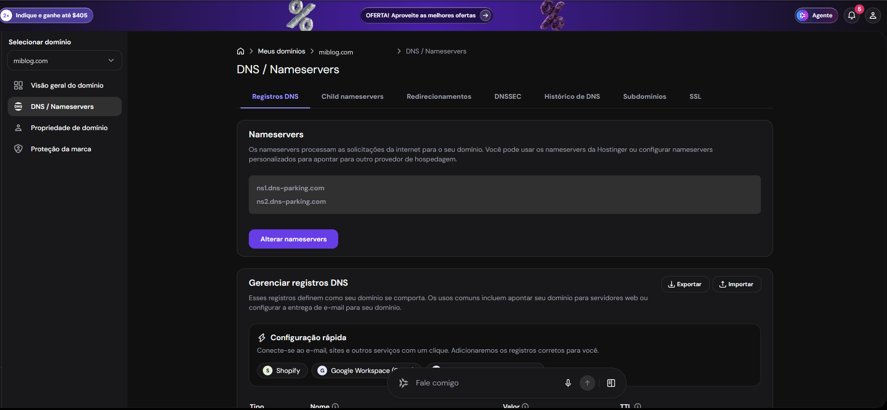

> **No toques "Alterar nameservers".** Eso cambia dónde vive tu página y puede dejarla sin funcionar.

**Paso 4.7.** Baja hasta **"Gerenciar registros DNS"** y llena la fila de arriba:

| Casilla | Qué poner |
|---|---|
| **Tipo** | `TXT` |
| **Nome** | `@` (solo la arroba) |
| **Valor** | El texto que copiaste de Facebook, completo (`facebook-domain-verification=...`) |
| **TTL** | Déjalo como está |

Toca **"Adicionar registro"**.

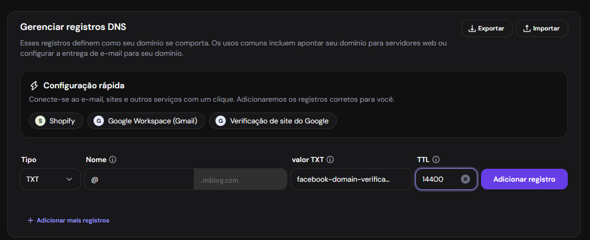

**Paso 4.8.** El registro nuevo aparece en la lista de abajo. Si ves otros registros parecidos (de Google o un código viejo de Facebook), **déjalos como están**: no molestan.

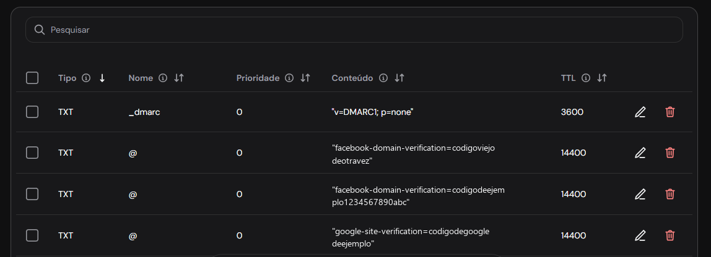

### De vuelta en Facebook: verificar

**Paso 4.9.** Vuelve a la pestaña de Facebook, baja hasta el final y toca **"Verificar dominio"**. Si todo salió bien, tu dominio pasa a **"Verificado"**.

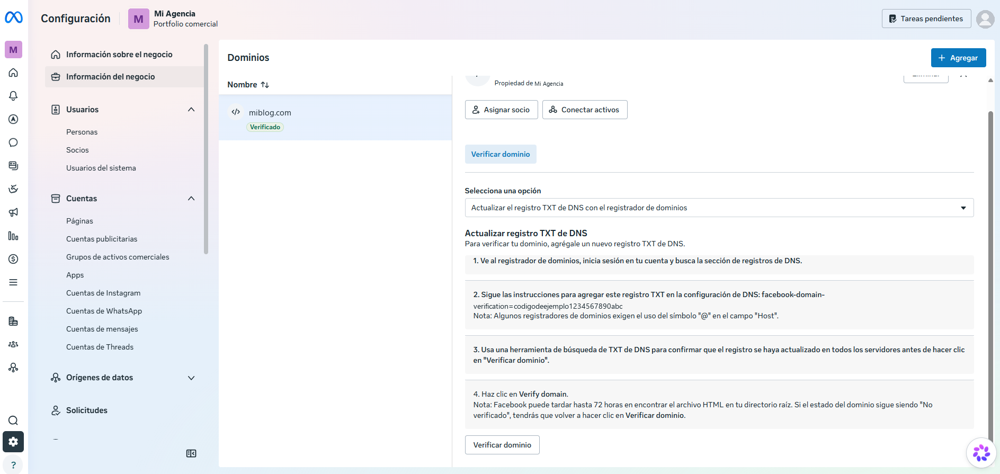

> **Si sigue "No verificado":** no pasa nada. Facebook avisa que puede tardar hasta **72 horas** en ver el registro. Vuelve más tarde y toca "Verificar dominio" otra vez.

> **¿Se puede deshacer?** Sí: en "Dominios", toca tu dominio y luego **"Eliminar"**. Deja el registro de Hostinger puesto: no estorba y sirve si un día lo vuelves a agregar.

---

## Parte 5. Datos y verificación del negocio (solo con empresa)

Facebook también permite poner los datos de tu negocio (nombre legal, dirección, teléfono y página web) y **verificar tu negocio** con documentos.

**Hazlo solo cuando tengas una empresa registrada** (por ejemplo, un CNPJ o MEI en Brasil). Facebook pide que los datos sean **exactamente iguales** a los de tus papeles oficiales; si no coinciden, rechaza la verificación. Y si después cambias un dato, hay que verificar todo de nuevo.

> Si todavía trabajas como persona, sin empresa, **deja esta parte para después**. Todo lo anterior funciona igual sin ella.

---

## Si algo sale mal

| Lo que ves | Qué hacer |
|---|---|
| No aparece "Personas" o no puedes cambiar la verificación en dos pasos | No tienes control total del portfolio. Pídeselo a quien lo tenga. |
| Facebook no te deja invitar | Quizá tienes que confirmar tu correo primero: en "Información sobre el negocio", más abajo, en tu información de contacto. |
| La persona no recibe el correo | Revisa que escribiste el correo de **su Facebook**. Que mire en spam. Si no, quítala y vuelve a invitarla. |
| No puedes elegir "Nadie" | Facebook dejó obligatoria la verificación para tu portfolio. Está bien así. |
| Al agregar el dominio, dice que ya está en otro negocio | Ese dominio está en otro portfolio (quizá uno tuyo viejo). Hay que eliminarlo de allá primero. |
| El dominio no se verifica | Revisa en Hostinger que el **Tipo** sea `TXT`, el **Nome** `@` y que el valor esté completo, sin espacios. Espera hasta 72 horas y vuelve a tocar "Verificar dominio". |

---

## Lo que viene

Próximamente, en esta misma guía: tu píxel principal.

---

Fuentes (ayuda oficial de Meta): [Exigir la verificación en dos pasos](https://www.facebook.com/business/help/280940009201586) · [Verificación de dominios](https://es-la.facebook.com/business/help/286768115176155) · [Verificar tu dominio](https://en-gb.facebook.com/business/help/321167023127050) · [Verificar tu negocio](https://www.facebook.com/business/help/2058515294227817) · [Agregar personas al portfolio](https://www.facebook.com/business/help/2169003770027706) · [Centro de seguridad](https://www.facebook.com/business/help/216940652189296) · [Una sola cuenta personal](https://www.facebook.com/help/975828035803295)
